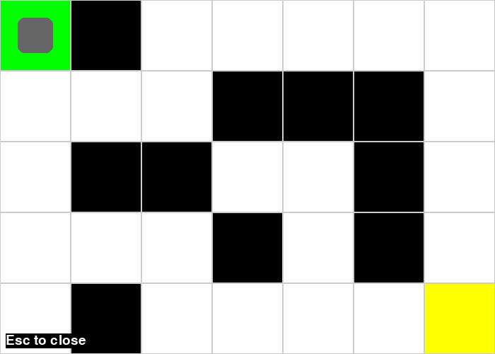

# Smarty Ratty

A mouse learns a maze with Q-learning. Made with NumPy and pygame.

## Run

    pip install numpy pygame-ce
    python index.py

Press Esc or close the window to stop.

## How it learns

Each cell is a state. Each move (up, down, left, right) is an action. The Q-table keeps a score for every state and action. After each move the score is updated:

    Q = Q + alpha * (reward + gamma * best next Q - Q)

At first the mouse moves at random. Over the episodes it picks the best known move more often.

## Settings

All at the top of `index.py`.

- `epsilon`: chance of a random move. Starts at 1.0, drops every episode, stops at 0.01.
- `alpha` (`learning_rate`): 0.1. How fast new info replaces old info.
- `gamma` (`discount_factor`): 0.95. How much future rewards matter.

Rewards:

- Cheese: +100
- Each move: -1
- Wall: -5 (the mouse stays in place)

An episode ends at the cheese or after 10 seconds.