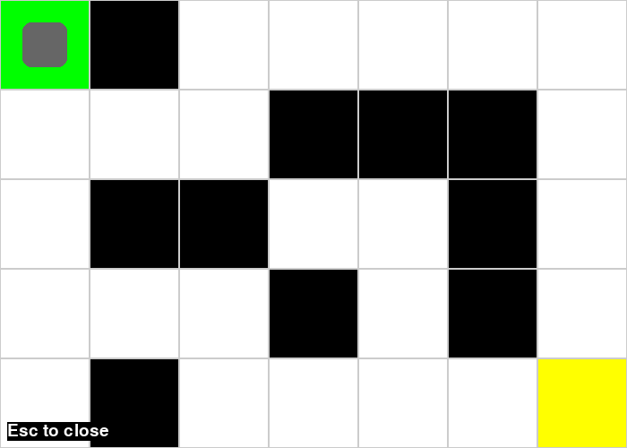

# 🐭 AI Smart Mouse: A Q-Learning Maze Solver

[](https://opensource.org/licenses/MIT)


A small, visual reinforcement-learning project. A mouse starts with zero knowledge of a maze and learns by trial and error with **Q-learning**. A Pygame window shows every move live, episode after episode, so you can watch it make mistakes and learn from them. Every run is different.

```
 S # . . . . .        S = start     C = cheese
 . . . # # # .        # = wall      . = open cell
 . # # . . # .
 . . . # . # .
 . # . . . . C
```

The maze has two routes on purpose: a short one along the bottom (10 steps) and a long one across the top and down the right side (12 steps). The open pocket in the middle is a dead end that only wastes moves.

---

## 📚 Table of Contents
* [Quick Start](#-quick-start)
* [What You'll See](#-what-youll-see)
* [How It Works](#-how-it-works)
* [Understanding the Code](#-understanding-the-code)
* [Tuning the Parameters](#-tuning-the-parameters)
* [License](#-license)

---

## 🚀 Quick Start

```bash
pip install numpy pygame-ce
python index.py
```

Training runs until you press **Esc** or close the window.

> `pygame-ce` is the community edition of `pygame` and a drop-in replacement; the code still says `import pygame`. Plain `pygame` has no prebuilt wheel for Python 3.14.

---

## 👀 What You'll See



The mouse (gray square) moves one cell per frame, 10 frames per second. The status line shows the episode, step, reward so far and epsilon. Each episode ends when the mouse reaches the cheese or after 10 seconds. The terminal prints one line per episode:

```
Episode <number>: <cheese or timeout> in <moves> steps, reward <points>, epsilon <value>
```

When you press Esc, the terminal prints a short summary: the episode it stopped in, epsilon, the learning rate, the discount factor and the rewards.

---

## 🧠 How It Works

**Reinforcement Learning (RL)** trains an **agent** to act in an **environment** so as to maximize cumulative **reward**.

| Concept     | In this project                                                                 |
| :---------- | :------------------------------------------------------------------------------ |
| **Agent**   | The mouse (gray square).                                                        |
| **State**   | Which maze cell the mouse is in (35 states for the 7×5 maze).                   |
| **Action**  | Move one cell **UP, DOWN, LEFT or RIGHT**.                                      |
| **Reward**  | See below.                                                                      |
| **Episode** | One attempt from the start cell until the cheese is found or 10 seconds pass.   |

### Rewards

| Event                                  | Reward  | Why                                           |
| :------------------------------------- | :-----: | :-------------------------------------------- |
| Reach the cheese                       |  `+100` | The goal. Ends the episode.                   |
| Any normal move                        |   `-1`  | Makes shorter paths score higher.             |
| Bump into a wall or the map edge       |   `-5`  | Discourages pointless moves.                  |

There is deliberately **no hint** about where the cheese or the dead ends are. The mouse works that out from these three rules alone.

### The Q-Table

A table with one **row per state** and one **column per action**. Each entry, the **Q-value**, estimates the total future reward of taking that action in that state. It starts as all zeros and training fills it in.

### The Learning Loop

1. **Choose an action (epsilon-greedy).** With probability **ε** pick a random action (explore); otherwise pick the action with the highest Q-value (exploit). ε starts at 1.0 and decays each episode, so the mouse explores early and exploits later.
2. **Act.** Move, and receive a reward and the new state.
3. **Update the Q-table** with the Bellman update:

   ```
   Q(s, a) ← Q(s, a) + α · ( reward + γ · max Q(s', ·) − Q(s, a) )
   ```

   Each update pulls the old estimate toward "reward now + best value I expect from the next cell". Repeated many times, the cheese's +100 spreads backwards along the path, one cell per update. At the terminal (cheese) state there is no future value, so the `γ · max Q` term is dropped.
4. **Repeat**, episode after episode, until you press Esc.

---

## 💻 Understanding the Code

Everything is in `index.py`, top to bottom:

| Piece | What it does |
| :---- | :----------- |
| `maze`, `unitSize` | The map (NumPy array) and the pixel size of one cell for drawing. |
| Settings & rewards | `learning_rate`, `discount_factor`, `epsilon_*`, `episode_time_limit`, `FPS`, `REWARD_*`. |
| `step(state, action)` | The environment: applies a move and returns `(new_state, reward, done)`. |
| `choose_action()` / `greedy_action()` | Epsilon-greedy policy. Ties are broken randomly, so an untrained row isn't biased toward "UP". |
| `update_q_table(...)` | The Bellman update. |
| `draw()` | Draws one frame (maze, mouse, status line) and waits so frames come at `FPS`. |
| `train(screen, font)` | Runs episodes until you quit, drawing every move. |
| `main()` | Opens the window, trains, and prints the summary when you stop. |

---

## 🔧 Tuning the Parameters

All at the top of `index.py`. Change one, run it, and watch what's different:

| Parameter | Default | Effect |
| :-------- | :-----: | :----- |
| `FPS` | `10` | Frames (moves) per second. Raise it to watch faster. |
| `episode_time_limit` | `10` | Seconds per episode before it counts as a timeout. |
| `learning_rate` (α) | `0.1` | Higher learns faster but is noisier; lower is steadier but slower. |
| `discount_factor` (γ) | `0.95` | Closer to 1 makes the mouse value the distant cheese more. Too low and the +100 fades before it reaches the start. |
| `epsilon_decay_rate` | `0.05` | How fast random moves fade, per episode. |
| `min_epsilon` | `0.01` | Exploration floor. |
| `REWARD_*` | `100 / -1 / -5` | Reshaping rewards changes behavior. Try `REWARD_STEP = 0` and watch what changes. |

You can also edit the `maze` array to design your own, as long as `S` and `C` are connected.

---

## 📄 License

This project is licensed under the MIT License. See the [LICENSE](LICENSE) file for details.
